<picture>
  <source media="(max-width: 640px)" srcset="https://raw.githubusercontent.com/MrTr4p/MrTr4p/main/assets/hero-mobile.svg" />
  
</picture>

  <a href="https://albosaty.dev"></a>
  <a href="https://www.linkedin.com/in/omar-riyad-7b032137b/"></a>
  <a href="mailto:omaralbosaty49@gmail.com"></a>

<picture>
  <source media="(max-width: 640px)" srcset="https://raw.githubusercontent.com/MrTr4p/MrTr4p/main/assets/personnel-mobile.svg" />
  
</picture>

<picture>
  <source media="(max-width: 640px)" srcset="https://raw.githubusercontent.com/MrTr4p/MrTr4p/main/assets/systems-mobile.svg" />
  
</picture>

<picture>
  <source media="(max-width: 640px)" srcset="https://raw.githubusercontent.com/MrTr4p/MrTr4p/main/assets/project-heading-mobile.svg" />
  
</picture>

<a href="https://github.com/MrTr4p/omar-arcade-portfolio">
  <picture>
    <source media="(max-width: 640px)" srcset="https://raw.githubusercontent.com/MrTr4p/MrTr4p/main/assets/project-01-mobile.svg" />
    
  </picture>
</a>

<a href="https://github.com/MrTr4p/distributed_job_execution">
  <picture>
    <source media="(max-width: 640px)" srcset="https://raw.githubusercontent.com/MrTr4p/MrTr4p/main/assets/project-02-mobile.svg" />
    
  </picture>
</a>

<a href="https://github.com/MrTr4p/ETL-Project">
  <picture>
    <source media="(max-width: 640px)" srcset="https://raw.githubusercontent.com/MrTr4p/MrTr4p/main/assets/project-03-mobile.svg" />
    
  </picture>
</a>

<a href="https://github.com/MrTr4p/rezero-grub-theme">
  <picture>
    <source media="(max-width: 640px)" srcset="https://raw.githubusercontent.com/MrTr4p/MrTr4p/main/assets/project-04-mobile.svg" />
    
  </picture>
</a>

  <a href="https://github.com/MrTr4p?tab=repositories"></a>

<a href="https://github.com/MrTr4p?tab=overview">
  <picture>
    <source media="(max-width: 640px)" srcset="https://raw.githubusercontent.com/MrTr4p/MrTr4p/main/assets/activity-mobile.svg" />
    
  </picture>
</a>

<code>&gt;&gt;&gt; OPEN CAM 05 / SPRINGTRAP</code>

  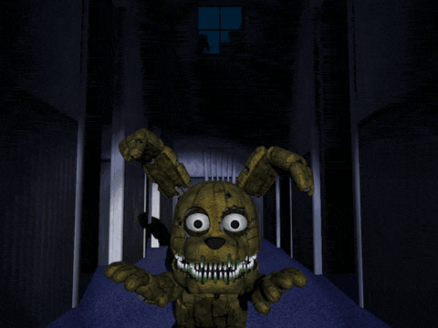

<code>&gt;&gt;&gt; READ THE PERSONNEL FILE / TEXT VERSION</code>

**Omar Albosaty · Software & Data Engineer · MrTr4p**

I build backend systems, APIs, data pipelines, and interactive interfaces. I also make game-inspired Linux themes and experiment with machine learning.

**Tools:** C#, ASP.NET Core, Node.js, NestJS, Redis, TypeScript, React, QML, Python, SQL, PostgreSQL, Pandas, Airflow, Linux, Docker, Git, and shell scripting.

**Selected projects**

- [Arcade portfolio](https://github.com/MrTr4p/omar-arcade-portfolio) — an interactive portfolio with React, TypeScript and Three.js.
- [Distributed job execution](https://github.com/MrTr4p/distributed_job_execution) — distributed job execution in C#.
- [ETL project](https://github.com/MrTr4p/ETL-Project) — Python, PostgreSQL and orchestration.
- [Re:Zero GRUB](https://github.com/MrTr4p/rezero-grub-theme) — a custom Arch Linux boot theme with installer and VM checks.

**More from the workshop:** [Hyprlock](https://github.com/MrTr4p/rezero-hyprlock) · [SDDM](https://github.com/MrTr4p/rezero-royal-capital-sddm) · [Elden Ring GRUB](https://github.com/MrTr4p/elden-erdtree-grub) · [Machine learning](https://github.com/MrTr4p/machine-learning-college)

[Portfolio](https://albosaty.dev) · [LinkedIn](https://www.linkedin.com/in/omar-riyad-7b032137b/) · [Email](mailto:omaralbosaty49@gmail.com)

<picture>
  <source media="(max-width: 640px)" srcset="https://raw.githubusercontent.com/MrTr4p/MrTr4p/main/assets/footer-mobile.svg" />
  
</picture>

FNAF fan profile · Characters belong to Scott Cawthon and their respective owners · <a href="./SOURCES.md">Art sources</a>

