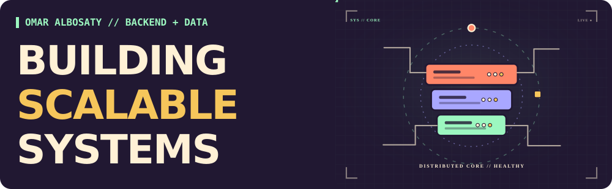

I'm **Omar Albosaty**, a software engineer at **Avnology** and a Computer Science student at **Damietta University**. I build backend services and data pipelines, and I work on the frontend when a feature needs both sides.

[Portfolio](https://albosaty.dev/) · [Résumé](https://albosaty.dev/resume.pdf) · [LinkedIn](https://linkedin.com/in/omar-riyad-7b032137b) · [Email](mailto:omaralbosaty49@gmail.com)

## Selected work

**[ETL Pipeline](https://albosaty.dev/work/etl-pipeline)** processes more than 12,000 transactions with a multithreaded Python engine. It captures database changes as they happen, converts currencies, and records an audit trail. [View source](https://github.com/MrTr4p/ETL-Project)

**[Distributed API](https://albosaty.dev/work/distributed-api)** uses NestJS and ASP.NET Core to coordinate authentication and sessions across services. The case study covers role-based access, Redis caching, and PostgreSQL query performance.

[Explore all work →](https://albosaty.dev/work)
