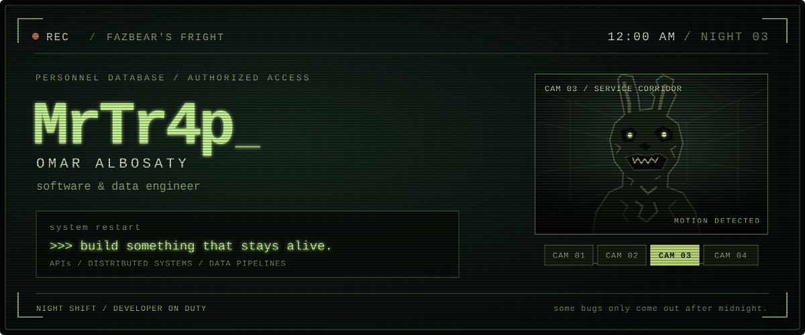
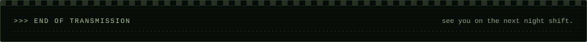

  

  <a href="https://albosaty.dev"><b>PORTFOLIO</b></a>
  &nbsp; / &nbsp;
  <a href="https://www.linkedin.com/in/omar-riyad-7b032137b/"><b>LINKEDIN</b></a>
  &nbsp; / &nbsp;
  <a href="https://github.com/MrTr4p?tab=repositories"><b>REPOSITORIES</b></a>

### `>>> personnel file`

I'm **Omar Albosaty**, a **software & data engineer** who likes building APIs, distributed systems, data pipelines, and interfaces with a little personality.

Away from the backend, I make game-inspired Linux themes and experiment with machine learning. This terminal takes its cues from **Five Nights at Freddy's 3**: green phosphor, surveillance cameras, and a maintenance menu that probably needs another reboot.

### `>>> maintenance panel`

| System | Tools on the workbench |
| :--- | :--- |
| **Backend** | C# · ASP.NET Core · TypeScript · Node.js · NestJS |
| **Data** | Python · SQL · PostgreSQL · Pandas · Airflow |
| **Interfaces** | React · TypeScript · QML |
| **Infrastructure** | Linux · Docker · Redis · Git |

### `>>> select camera`

| Feed | Project | What's inside |
| :--- | :--- | :--- |
| <code>CAM&nbsp;01</code> | [**Arcade portfolio**](https://github.com/MrTr4p/omar-arcade-portfolio) | An interactive developer portfolio built with React, TypeScript, and Three.js. |
| <code>CAM&nbsp;02</code> | [**Distributed job execution**](https://github.com/MrTr4p/distributed_job_execution) | Distributed job execution in C#. |
| <code>CAM&nbsp;03</code> | [**ETL project**](https://github.com/MrTr4p/ETL-Project) | Python data pipelines with PostgreSQL and orchestration. |
| <code>CAM&nbsp;04</code> | [**Re:Zero GRUB theme**](https://github.com/MrTr4p/rezero-grub-theme) | A custom Arch Linux boot theme with an installer, backups, and BIOS/UEFI VM checks. |

<code>&gt;&gt;&gt; open the parts &amp; service room</code>

More things from the workshop:

- [Re:Zero Hyprlock](https://github.com/MrTr4p/rezero-hyprlock) — a custom lock screen for Hyprland.
- [Royal Capital SDDM](https://github.com/MrTr4p/rezero-royal-capital-sddm) — an animated login theme in QML.
- [Elden Ring GRUB](https://github.com/MrTr4p/elden-erdtree-grub) — an Erdtree scene for the boot menu.
- [Machine learning notebooks](https://github.com/MrTr4p/machine-learning-college) — experiments and coursework.

 

  

