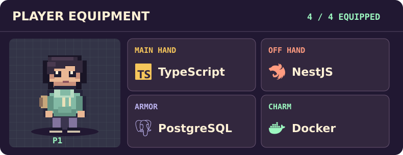
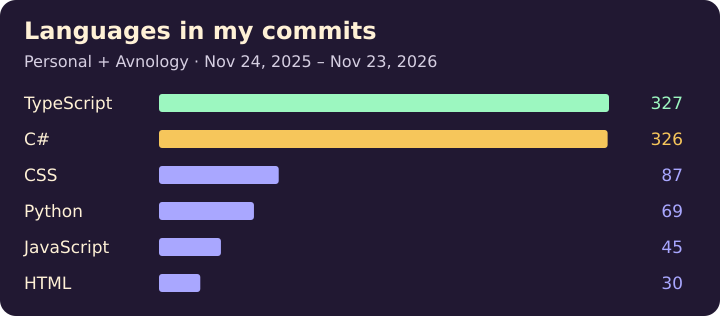

I'm **Omar Albosaty**, a software engineer at **Avnology** and a Computer Science student at **Damietta University**. My main languages are **TypeScript and C#**. I build backend services and data pipelines, and I work on the frontend when a feature needs both sides.

[Portfolio](https://albosaty.dev/) · [Résumé](https://albosaty.dev/resume.pdf) · [LinkedIn](https://linkedin.com/in/omar-riyad-7b032137b) · [Email](mailto:omaralbosaty49@gmail.com)

## Skills

### The player’s toolkit

Open a specialty to explore its loadout.

<strong>Backend</strong> · The system builder

I build APIs and authentication services at Avnology using C# and ASP.NET Core alongside my TypeScript stack.

**Inventory** · C# · ASP.NET Core · TypeScript · Node.js · NestJS · AdonisJS · MikroORM · PostgreSQL

<strong>Data engineering</strong> · The data navigator

My ETL pipeline captures changes, converts currencies, and keeps an audit trail as transactions move through the system.

**Inventory** · Python · SQL · PostgreSQL · Airflow · Kafka · Azure

<strong>Frontend</strong> · The interface builder

I use these tools to build the screens and interactions in my portfolio and connect product interfaces to backend services.

**Inventory** · React · Next.js · TypeScript · JavaScript · Tailwind CSS · React Router · HTML · CSS · Vite · npm · Git

<strong>ML &amp; computer vision</strong> · The pattern finder

My projects range from predicting California housing prices to classifying CIFAR-10 images and detecting fruit with YOLO.

**Inventory** · Python · NumPy · pandas · scikit-learn · TensorFlow · YOLO

<strong>Systems &amp; Linux</strong> · Under the hood

I use Arch Linux daily and explore memory, networking, and distributed systems through ShardLab.

**Inventory** · C++ · Linux · Docker · Git · SQLite · Zsh

[Equip items in the interactive portfolio →](https://albosaty.dev/about#inventory-equipment)

## Selected work

**[ETL Pipeline](https://albosaty.dev/work/etl-pipeline)** processes more than 12,000 transactions with a multithreaded Python engine. It captures database changes as they happen, converts currencies, and records an audit trail. [View source](https://github.com/MrTr4p/ETL-Project)

**[Distributed API](https://albosaty.dev/work/distributed-api)** uses NestJS and ASP.NET Core to coordinate authentication and sessions across services. The case study covers role-based access, Redis caching, and PostgreSQL query performance.

[Explore all work →](https://albosaty.dev/work)

## GitHub activity

**116 contributions across 37 active days** from December 1, 2025 through November 23, 2026, according to my public GitHub calendar.

### Languages in my commits

TypeScript and C# are my two most-used languages by commit count across my personal and Avnology repositories. A commit counts once for each language I added or edited.

Read the chart values

| Month | Contributions |
| --- | ---: |
| Dec 2025 | 18 |
| Jan 2026 | 8 |
| Feb 2026 | 5 |
| Mar 2026 | 0 |
| Apr 2026 | 3 |
| May 2026 | 2 |
| Jun 2026 | 3 |
| Jul 2026 | 2 |
| Aug 2026 | 28 |
| Sep 2026 | 18 |
| Oct 2026 | 23 |
| Nov 2026 | 6 |

| Language | Authored commits |
| --- | ---: |
| TypeScript | 327 |
| C# | 326 |
| CSS | 87 |
| Python | 69 |
| JavaScript | 45 |
| HTML | 30 |
| Shell | 20 |
| C++ | 6 |
| QML | 4 |
| Go | 1 |
| Java | 1 |
| PowerShell | 1 |
| SCSS | 1 |
| SQL | 1 |

