<picture><source media="(max-width: 640px) and (prefers-color-scheme: dark)" srcset="https://raw.githubusercontent.com/MrTr4p/MrTr4p/main/assets/terminal/banner-mobile-dark.svg"><source media="(max-width: 640px) and (prefers-color-scheme: light)" srcset="https://raw.githubusercontent.com/MrTr4p/MrTr4p/main/assets/terminal/banner-mobile-light.svg"><source media="(prefers-color-scheme: dark)" srcset="https://raw.githubusercontent.com/MrTr4p/MrTr4p/main/assets/terminal/banner-dark.svg"><source media="(prefers-color-scheme: light)" srcset="https://raw.githubusercontent.com/MrTr4p/MrTr4p/main/assets/terminal/banner-light.svg"></picture>

<a href="#camera-feeds"><picture><source media="(max-width: 640px) and (prefers-color-scheme: dark)" srcset="https://raw.githubusercontent.com/MrTr4p/MrTr4p/main/assets/terminal/nav-projects-mobile-dark.svg"><source media="(max-width: 640px) and (prefers-color-scheme: light)" srcset="https://raw.githubusercontent.com/MrTr4p/MrTr4p/main/assets/terminal/nav-projects-mobile-light.svg"><source media="(prefers-color-scheme: dark)" srcset="https://raw.githubusercontent.com/MrTr4p/MrTr4p/main/assets/terminal/nav-projects-dark.svg"><source media="(prefers-color-scheme: light)" srcset="https://raw.githubusercontent.com/MrTr4p/MrTr4p/main/assets/terminal/nav-projects-light.svg"></picture></a><a href="#maintenance"><picture><source media="(max-width: 640px) and (prefers-color-scheme: dark)" srcset="https://raw.githubusercontent.com/MrTr4p/MrTr4p/main/assets/terminal/nav-maintenance-mobile-dark.svg"><source media="(max-width: 640px) and (prefers-color-scheme: light)" srcset="https://raw.githubusercontent.com/MrTr4p/MrTr4p/main/assets/terminal/nav-maintenance-mobile-light.svg"><source media="(prefers-color-scheme: dark)" srcset="https://raw.githubusercontent.com/MrTr4p/MrTr4p/main/assets/terminal/nav-maintenance-dark.svg"><source media="(prefers-color-scheme: light)" srcset="https://raw.githubusercontent.com/MrTr4p/MrTr4p/main/assets/terminal/nav-maintenance-light.svg"></picture></a><a href="#security-log"><picture><source media="(max-width: 640px) and (prefers-color-scheme: dark)" srcset="https://raw.githubusercontent.com/MrTr4p/MrTr4p/main/assets/terminal/nav-activity-mobile-dark.svg"><source media="(max-width: 640px) and (prefers-color-scheme: light)" srcset="https://raw.githubusercontent.com/MrTr4p/MrTr4p/main/assets/terminal/nav-activity-mobile-light.svg"><source media="(prefers-color-scheme: dark)" srcset="https://raw.githubusercontent.com/MrTr4p/MrTr4p/main/assets/terminal/nav-activity-dark.svg"><source media="(prefers-color-scheme: light)" srcset="https://raw.githubusercontent.com/MrTr4p/MrTr4p/main/assets/terminal/nav-activity-light.svg"></picture></a><a href="#contact"><picture><source media="(max-width: 640px) and (prefers-color-scheme: dark)" srcset="https://raw.githubusercontent.com/MrTr4p/MrTr4p/main/assets/terminal/nav-contact-mobile-dark.svg"><source media="(max-width: 640px) and (prefers-color-scheme: light)" srcset="https://raw.githubusercontent.com/MrTr4p/MrTr4p/main/assets/terminal/nav-contact-mobile-light.svg"><source media="(prefers-color-scheme: dark)" srcset="https://raw.githubusercontent.com/MrTr4p/MrTr4p/main/assets/terminal/nav-contact-dark.svg"><source media="(prefers-color-scheme: light)" srcset="https://raw.githubusercontent.com/MrTr4p/MrTr4p/main/assets/terminal/nav-contact-light.svg"></picture></a>

<strong><code>&gt;&gt;&gt; PERSONNEL FILE / OPEN</code></strong>

I'm **Omar Albosaty**, a **software & data engineer**. I build APIs, distributed systems, data pipelines, and interactive interfaces. I also make game-inspired Linux themes and experiment with machine learning.

[Portfolio](https://albosaty.dev) · [LinkedIn](https://www.linkedin.com/in/omar-riyad-7b032137b/) · [Email](mailto:omaralbosaty49@gmail.com)

## Camera feeds

Select a feed to open its repository.

<a href="https://github.com/MrTr4p/omar-arcade-portfolio"><picture><source media="(max-width: 640px) and (prefers-color-scheme: dark)" srcset="https://raw.githubusercontent.com/MrTr4p/MrTr4p/main/assets/terminal/project-01-mobile-dark.svg"><source media="(max-width: 640px) and (prefers-color-scheme: light)" srcset="https://raw.githubusercontent.com/MrTr4p/MrTr4p/main/assets/terminal/project-01-mobile-light.svg"><source media="(prefers-color-scheme: dark)" srcset="https://raw.githubusercontent.com/MrTr4p/MrTr4p/main/assets/terminal/project-01-dark.svg"><source media="(prefers-color-scheme: light)" srcset="https://raw.githubusercontent.com/MrTr4p/MrTr4p/main/assets/terminal/project-01-light.svg"></picture></a><a href="https://github.com/MrTr4p/distributed_job_execution"><picture><source media="(max-width: 640px) and (prefers-color-scheme: dark)" srcset="https://raw.githubusercontent.com/MrTr4p/MrTr4p/main/assets/terminal/project-02-mobile-dark.svg"><source media="(max-width: 640px) and (prefers-color-scheme: light)" srcset="https://raw.githubusercontent.com/MrTr4p/MrTr4p/main/assets/terminal/project-02-mobile-light.svg"><source media="(prefers-color-scheme: dark)" srcset="https://raw.githubusercontent.com/MrTr4p/MrTr4p/main/assets/terminal/project-02-dark.svg"><source media="(prefers-color-scheme: light)" srcset="https://raw.githubusercontent.com/MrTr4p/MrTr4p/main/assets/terminal/project-02-light.svg"></picture></a>

<a href="https://github.com/MrTr4p/ETL-Project"><picture><source media="(max-width: 640px) and (prefers-color-scheme: dark)" srcset="https://raw.githubusercontent.com/MrTr4p/MrTr4p/main/assets/terminal/project-03-mobile-dark.svg"><source media="(max-width: 640px) and (prefers-color-scheme: light)" srcset="https://raw.githubusercontent.com/MrTr4p/MrTr4p/main/assets/terminal/project-03-mobile-light.svg"><source media="(prefers-color-scheme: dark)" srcset="https://raw.githubusercontent.com/MrTr4p/MrTr4p/main/assets/terminal/project-03-dark.svg"><source media="(prefers-color-scheme: light)" srcset="https://raw.githubusercontent.com/MrTr4p/MrTr4p/main/assets/terminal/project-03-light.svg"></picture></a><a href="https://github.com/MrTr4p/rezero-grub-theme"><picture><source media="(max-width: 640px) and (prefers-color-scheme: dark)" srcset="https://raw.githubusercontent.com/MrTr4p/MrTr4p/main/assets/terminal/project-04-mobile-dark.svg"><source media="(max-width: 640px) and (prefers-color-scheme: light)" srcset="https://raw.githubusercontent.com/MrTr4p/MrTr4p/main/assets/terminal/project-04-mobile-light.svg"><source media="(prefers-color-scheme: dark)" srcset="https://raw.githubusercontent.com/MrTr4p/MrTr4p/main/assets/terminal/project-04-dark.svg"><source media="(prefers-color-scheme: light)" srcset="https://raw.githubusercontent.com/MrTr4p/MrTr4p/main/assets/terminal/project-04-light.svg"></picture></a>

<strong><code>&gt;&gt;&gt; OPEN ADDITIONAL FEEDS</code></strong>

- [Re:Zero Hyprlock](https://github.com/MrTr4p/rezero-hyprlock) — a custom Hyprland lock screen.
- [Royal Capital SDDM](https://github.com/MrTr4p/rezero-royal-capital-sddm) — an animated login theme in QML.
- [Elden Ring GRUB](https://github.com/MrTr4p/elden-erdtree-grub) — an Erdtree scene for the boot menu.
- [Machine learning notebooks](https://github.com/MrTr4p/machine-learning-college) — experiments and coursework.

[All repositories →](https://github.com/MrTr4p?tab=repositories)

## Maintenance

<picture><source media="(max-width: 640px) and (prefers-color-scheme: dark)" srcset="https://raw.githubusercontent.com/MrTr4p/MrTr4p/main/assets/terminal/maintenance-mobile-dark.svg"><source media="(max-width: 640px) and (prefers-color-scheme: light)" srcset="https://raw.githubusercontent.com/MrTr4p/MrTr4p/main/assets/terminal/maintenance-mobile-light.svg"><source media="(prefers-color-scheme: dark)" srcset="https://raw.githubusercontent.com/MrTr4p/MrTr4p/main/assets/terminal/maintenance-dark.svg"><source media="(prefers-color-scheme: light)" srcset="https://raw.githubusercontent.com/MrTr4p/MrTr4p/main/assets/terminal/maintenance-light.svg"></picture>

<strong><code>&gt;&gt;&gt; BACKEND SYSTEMS / EXPAND</code></strong>

**C# · ASP.NET Core · Node.js · NestJS · Redis**

APIs, distributed execution, and backend services.

[Inspect distributed job execution →](https://github.com/MrTr4p/distributed_job_execution)

<strong><code>&gt;&gt;&gt; DATA SYSTEMS / EXPAND</code></strong>

**Python · SQL · PostgreSQL · Pandas · Airflow**

Data pipelines, transformation, orchestration, and machine learning experiments.

[Inspect ETL pipelines →](https://github.com/MrTr4p/ETL-Project) · [Open ML notebooks →](https://github.com/MrTr4p/machine-learning-college)

<strong><code>&gt;&gt;&gt; INTERFACES &amp; LINUX / EXPAND</code></strong>

**TypeScript · React · QML · Linux · Docker · Git**

Interactive interfaces and custom desktop, login, lock-screen, and boot experiences.

[Inspect the arcade portfolio →](https://github.com/MrTr4p/omar-arcade-portfolio) · [Open Linux themes →](https://github.com/MrTr4p/rezero-grub-theme)

## Security log

<picture><source media="(max-width: 640px) and (prefers-color-scheme: dark)" srcset="https://raw.githubusercontent.com/MrTr4p/MrTr4p/main/assets/terminal/numbers-mobile-dark.svg"><source media="(max-width: 640px) and (prefers-color-scheme: light)" srcset="https://raw.githubusercontent.com/MrTr4p/MrTr4p/main/assets/terminal/numbers-mobile-light.svg"><source media="(prefers-color-scheme: dark)" srcset="https://raw.githubusercontent.com/MrTr4p/MrTr4p/main/assets/terminal/numbers-dark.svg"><source media="(prefers-color-scheme: light)" srcset="https://raw.githubusercontent.com/MrTr4p/MrTr4p/main/assets/terminal/numbers-light.svg"></picture>

<picture><source media="(max-width: 640px) and (prefers-color-scheme: dark)" srcset="https://raw.githubusercontent.com/MrTr4p/MrTr4p/main/assets/terminal/activity-mobile-dark.svg"><source media="(max-width: 640px) and (prefers-color-scheme: light)" srcset="https://raw.githubusercontent.com/MrTr4p/MrTr4p/main/assets/terminal/activity-mobile-light.svg"><source media="(prefers-color-scheme: dark)" srcset="https://raw.githubusercontent.com/MrTr4p/MrTr4p/main/assets/terminal/activity-dark.svg"><source media="(prefers-color-scheme: light)" srcset="https://raw.githubusercontent.com/MrTr4p/MrTr4p/main/assets/terminal/activity-light.svg"></picture>

<strong><code>&gt;&gt;&gt; OPEN THE ACTIVITY LOG</code></strong>

Public GitHub activity from **2025-11-23** to **2026-11-23**.

| Month | Contributions |
| :--- | ---: |
| 2025-11 | 16 |
| 2025-12 | 18 |
| 2026-01 | 8 |
| 2026-02 | 5 |
| 2026-03 | 0 |
| 2026-04 | 3 |
| 2026-05 | 2 |
| 2026-06 | 3 |
| 2026-07 | 2 |
| 2026-08 | 28 |
| 2026-09 | 18 |
| 2026-10 | 23 |
| 2026-11 | 4 |

**Recent active days**

| Date | Contributions |
| :--- | ---: |
| 2026-11-23 | 3 |
| 2026-11-02 | 1 |
| 2026-10-16 | 8 |
| 2026-10-15 | 10 |
| 2026-10-14 | 1 |
| 2026-10-13 | 3 |
| 2026-10-05 | 1 |
| 2026-09-15 | 9 |
| 2026-09-14 | 5 |
| 2026-09-04 | 2 |
| 2026-09-03 | 2 |
| 2026-08-09 | 1 |

[Open the current GitHub activity →](https://github.com/MrTr4p?tab=overview)

## Contact

[**PORTFOLIO ↗**](https://albosaty.dev) &nbsp; / &nbsp; [**LINKEDIN ↗**](https://www.linkedin.com/in/omar-riyad-7b032137b/) &nbsp; / &nbsp; [**EMAIL ↗**](mailto:omaralbosaty49@gmail.com)

<a href="#"><picture><source media="(max-width: 640px) and (prefers-color-scheme: dark)" srcset="https://raw.githubusercontent.com/MrTr4p/MrTr4p/main/assets/terminal/footer-mobile-dark.svg"><source media="(max-width: 640px) and (prefers-color-scheme: light)" srcset="https://raw.githubusercontent.com/MrTr4p/MrTr4p/main/assets/terminal/footer-mobile-light.svg"><source media="(prefers-color-scheme: dark)" srcset="https://raw.githubusercontent.com/MrTr4p/MrTr4p/main/assets/terminal/footer-dark.svg"><source media="(prefers-color-scheme: light)" srcset="https://raw.githubusercontent.com/MrTr4p/MrTr4p/main/assets/terminal/footer-light.svg"></picture></a>

FNAF-inspired terminal theme · Original vector graphics · Motion respects your reduced-motion setting.
