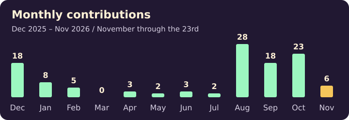
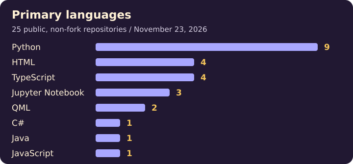

I'm **Omar Albosaty**, a software engineer at **Avnology** and a Computer Science student at **Damietta University**. I build backend services and data pipelines, and I work on the frontend when a feature needs both sides.

[Portfolio](https://albosaty.dev/) · [Résumé](https://albosaty.dev/resume.pdf) · [LinkedIn](https://linkedin.com/in/omar-riyad-7b032137b) · [Email](mailto:omaralbosaty49@gmail.com)

## Skills

| Area | Tools and practice |
| --- | --- |
| Backend | TypeScript, Node.js, NestJS, AdonisJS, C#, ASP.NET Core · REST APIs, authentication, and session management |
| Data engineering | Python, SQL, Kafka, Airflow, Spark · change data capture and ETL pipelines |
| Databases | PostgreSQL, Redis, MongoDB · data modeling, caching, and query optimization |
| Frontend | React, Next.js, Tailwind CSS, Vite · interfaces that connect to backend services |
| Machine learning | pandas, NumPy, scikit-learn · data preparation, regression, and classification |
| Systems | Arch Linux, Docker, Azure, Git |

[Explore my toolkit on the portfolio →](https://albosaty.dev/about)

## Selected work

**[ETL Pipeline](https://albosaty.dev/work/etl-pipeline)** processes more than 12,000 transactions with a multithreaded Python engine. It captures database changes as they happen, converts currencies, and records an audit trail. [View source](https://github.com/MrTr4p/ETL-Project)

**[Distributed API](https://albosaty.dev/work/distributed-api)** uses NestJS and ASP.NET Core to coordinate authentication and sessions across services. The case study covers role-based access, Redis caching, and PostgreSQL query performance.

[Explore all work →](https://albosaty.dev/work)

## GitHub activity

**116 contributions across 37 active days** from December 1, 2025 through November 23, 2026, according to my public GitHub calendar.

Read the chart values

| Month | Contributions |
| --- | ---: |
| Dec 2025 | 18 |
| Jan 2026 | 8 |
| Feb 2026 | 5 |
| Mar 2026 | 0 |
| Apr 2026 | 3 |
| May 2026 | 2 |
| Jun 2026 | 3 |
| Jul 2026 | 2 |
| Aug 2026 | 28 |
| Sep 2026 | 18 |
| Oct 2026 | 23 |
| Nov 2026 | 6 |

| Primary language | Repositories |
| --- | ---: |
| Python | 9 |
| HTML | 4 |
| TypeScript | 4 |
| Jupyter Notebook | 3 |
| QML | 2 |
| C# | 1 |
| Java | 1 |
| JavaScript | 1 |

